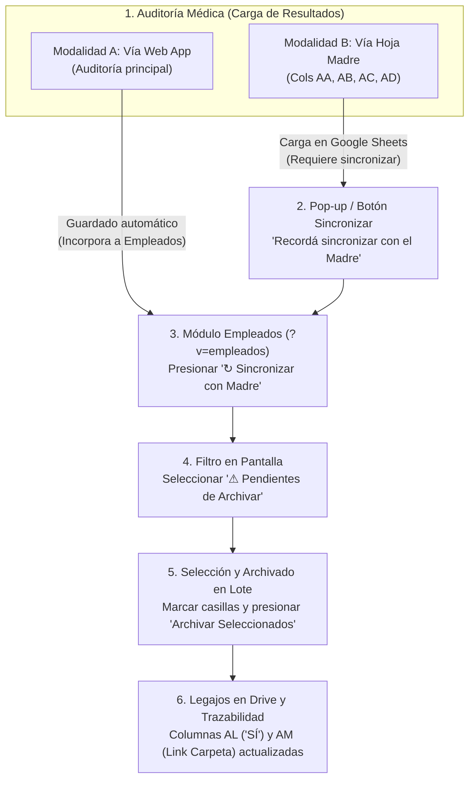

# Manual de Usuario: Módulo de Control de Legajos y Empleados
**Auditoría Médica 2026 · Grupo Río Varadero (GRV)**

---

## 1. El Proceso de Auditoría Médica: Modalidades de Carga

Antes de gestionar el archivado y control de legajos en el módulo `Empleados`, los estudios deben ser auditados. La carga de la auditoría médica puede realizarse de **dos modalidades distintas**:

### Modalidad A: Desde la Web App de Auditoría (Recomendada)
Es el método habitual y más seguro para la práctica médica:
1. Se accede a la vista principal de la aplicación (**Auditoría Médica**).
2. Se utilizan los filtros combinados (Contrato, Organismo, SRT, Establecimiento, Empleado, etc.).
3. El médico visualiza el estudio adjunto (Link1 / PDF) y asigna el **Resultado** mediante el selector desplegable.
4. Puede ingresar observaciones clínicas en el campo **Observación** (campo habilitado para todos los resultados, incluyendo *Normal Laboral*).
5. Al pulsar **Guardar**, el sistema:
   - Registra de inmediato la auditoría en la Hoja Madre en menos de 1,5 segundos.
   - Si el empleado no estaba previamente en la hoja `Empleados`, lo incorpora automáticamente en tiempo real como **Pendiente de Archivar**.
   - Muestra el aviso recordatorio para acudir al módulo de Empleados.

---

### Modalidad B: Directamente desde el Archivo de Cálculo ("Hoja Madre")
En ocasiones, la auditoría puede cargarse de forma manual y directa en la propia hoja de cálculo de Google Sheets (por ejemplo, al realizar cargas masivas mediante fórmulas, cruces externos o importaciones de datos).

#### Columnas obligatorias que deben completarse en la Hoja Madre:
Para que el sistema reconozca un estudio como auditado, deben completarse las siguientes columnas en la fila correspondiente:
- **Columna 27 (AA) — `Fecha_auditoria`**: Fecha en la que se dictamina la auditoría (formato `DD/MM/AAAA`). Si se deja vacía al cargar el resultado en la Hoja Madre, el sistema **le estampará automáticamente la fecha de hoy** al pulsar *Sincronizar con Madre*.
- **Columna 28 (AB) — `Fecha` (Fecha de Estudio)**: Fecha en que se realizó la práctica médica (formato `DD/MM/AAAA`).
- **Columna 29 (AC) — `Resultado`**: Debe contener exactamente uno de los valores oficiales permitidos del sistema:
  - `Normal Laboral`
  - `Pendiente de Confirmación`
  - `Desvío`
  - `Ausente/Sin realizar`
  - `Ausente`
  - `Enfermedad Profesional`
  - `Práctica defectuosa`
  - `Desistido`
- **Columna 30 (AD) — `Observación`**: Texto explicativo, hallazgo patológico o aclaraciones sobre el estudio (opcional en general, pero **estrictamente OBLIGATORIA** cuando el resultado es `Desistido` para asentar el motivo del cierre administrativo/médico).

#### ¿Qué hacer después de auditar directamente en la Hoja Madre? (PASO CRÍTICO)
> [!IMPORTANT]
> **Paso Indispensable al cargar en la Hoja Madre:**
> Dado que la edición manual en Google Sheets ocurre por fuera de la Web App, el sistema web no se entera en tiempo real de los cambios hasta que se ejecute la sincronización.
>
> Para que los nuevos casos auditados aparezcan en el módulo `Empleados`, debes realizar estos pasos:
> 1. Abrir la aplicación web y entrar al módulo **`Empleados`** (haciendo clic en el botón *Empleados* en la barra superior o mediante `?v=empleados`).
> 2. Al ingresar, verás el pop-up de aviso: *`🔔 Recordá sincronizar con el Madre`*.
> 3. Hacer clic en el botón **`[ ↻ Sincronizar Ahora ]`** (en el pop-up) o en **`↻ Sincronizar con Madre`** (en la barra superior).
> 4. En pocos segundos, el sistema:
>    - Leerá todos los resultados cargados en la Hoja Madre.
>    - Agrupará los estudios por empleado (CUIL).
>    - Actualizará la hoja dedicada `Empleados`.
>    - Clasificará a los trabajadores en **100% Auditados** o **Auditoría Parcial**.
>    - Listará a todos los recién auditados como **`⚠ Pendientes de Archivar`**, listos para que sus legajos sean guardados en Google Drive con un solo clic.

---

## 2. Objetivo del Módulo de Empleados

El **Módulo de Control de Legajos y Empleados** (`?v=empleados`) es una herramienta diseñada para supervisar y gestionar el proceso de auditoría médica a nivel de **empleado / legajo completo**, complementando la auditoría estudio por estudio que se realiza en la vista principal o en la Hoja Madre.

### Objetivos Principales:
1. **Visión Consolidada por Empleado**: Agrupar los múltiples estudios médicos de un mismo trabajador en una sola fila (ej.: Audiometría, Rx Tórax, Laboratorio, ECG).
2. **Control de Avance**: Saber de un vistazo si un empleado está **100% Auditado** o tiene **Auditoría Parcial**.
3. **Gestión de Archivador Digital en Google Drive**:
   - Identificar rápidamente qué empleados están **Pendientes de Archivar** y cuáles ya están **Archivados**.
   - Archivar los PDFs médicos en Drive generando **un único legajo por empleado** (sin duplicar copias cuando un empleado tiene múltiples estudios).
4. **Trazabilidad Total**: Vincular automáticamente cada fila con la Hoja Madre a través de las columnas:
   - **AL (`Guardado`)**: Registra `"SÍ"` cuando el PDF fue archivado.
   - **AM (`Link_carpeta`)**: Contiene el enlace directo a la carpeta en Google Drive del establecimiento donde se guardó el legajo.

---

## 3. Acceso al Módulo

Se puede acceder al módulo de dos maneras:
- **Desde la barra superior de la Web App**: Haciendo clic en el botón con ícono de personas **`Empleados`**.
- **Desde la URL**: Agregando el parámetro `?v=empleados` a la dirección de la aplicación web:
  ```text
  https://script.google.com/macros/s/.../exec?v=empleados
  ```

---

## 4. Pantalla Principal y Panel Lateral de Filtros e Indicadores

El módulo cuenta con un **Panel Lateral interactivo y colapsable** que agrupa los 8 indicadores clave del operativo y actúa como un sistema de **filtros rápidos con un solo clic**.

```text
+----------------------------------------------------------------------------------------------------------------+
|  [Logo GRV] Control de Legajos y Empleados       [Archivar Seleccionados (0)] [Indicadores & Filtros] [↻ Sync] |
+----------------------------------------------------------------------------------------------------------------+
| [◀ PANEL LATERAL COLAPSABLE]        | [ ÁREA PRINCIPAL DE TRABAJO ]                                            |
|                                     | [ Barra de búsqueda: CUIL, Empleado, Contrato... ] [ Filtro Activo: X ]  |
| 1. Total con Link (Madre)     1.863 |--------------------------------------------------------------------------|
| 2. Pendientes de Auditar      1.863 | [x] | CUIL        | Empleado    | Establecimiento | Aud. | AL  | AM  | Acción |
| 3. Empleados Auditados          451 | [ ] | 20-33445566 | PÉREZ, JUAN | PLANTA NORTE    | Comp | SÍ  | Ver | [v] [☁]|
| 4. Archivados en Drive            0 |--------------------------------------------------------------------------|
| 5. Pendientes Archivar          451 |                                                                          |
| 6. Incompletos (Ausentes)        17 |                                                                          |
| 7. Presentes sin Link             2 |                                                                          |
| 8. Parciales (En Proceso)         0 |                                                                          |
+-------------------------------------+--------------------------------------------------------------------------+
```

### 4.1. Panel Lateral de Indicadores y Filtros Interactivos (8 Métricas)
Cada tarjeta del panel lateral cumple una **doble función**: muestra el recuento actualizado y, al hacer clic sobre ella, **filtra instantáneamente la tabla**:

1. **Total con Link (Madre)**: Total consolidado de trabajadores únicos que poseen al menos un estudio con link adjunto en la Hoja Madre.
2. **Pendientes de Auditar**: Trabajadores que poseen link disponible en Madre pero aún no tienen dictamen médico finalizado (legajos listos para auditar).
3. **Empleados Auditados**: Trabajadores que tienen el 100% de sus estudios realizados y auditados (sin ausencias).
4. **Archivados en Drive**: Empleados cuyos legajos ya fueron respaldados y copiados en las carpetas de Google Drive (Columna AL: `SÍ`).
5. **Pendientes de Archivar (sin incompletos)**: Trabajadores listos para respaldar en Google Drive. **No incluye trabajadores con estudios incompletos/ausentes**, garantizando que sólo se archiven legajos íntegros.
6. **Incompletos (Ausentes)**: Trabajadores que faltaron o no se realizaron 1 o más estudios (*"Ausente / Sin realizar"*).
7. **Presentes sin Link**: Trabajadores que concurrieron con asistencia confirmada (`PRESENTE`) pero a los que el prestador médico aún no les adjuntó el PDF.
8. **Parciales (En Proceso)**: Empleados con auditoría médica sin finalizar (celdas en blanco o estudios pendientes).

* **Comportamiento interactivo:**
  - Al hacer clic en cualquiera de las 8 tarjetas, la tabla se filtra automáticamente por ese criterio y la tarjeta queda resaltada con borde cian.
  - Al hacer clic nuevamente sobre la tarjeta activa (o en el botón `✕ Quitar`), el filtro se desactiva y se muestran todos los registros.
  - El panel lateral se puede **colapsar o expandir** mediante el botón `[ ◀ ]` del panel o el botón **`[Indicadores & Filtros]`** del menú superior y de la barra de filtros, recordando la preferencia del usuario.

---

## 5. Búsqueda y Filtros

La barra de filtros permite acotar rápidamente los empleados en pantalla:

1. **Buscadores de Texto**:
   - Permiten escribir por **CUIL**, **Empleado / Nombre**, **Contrato / SRT**, **Establecimiento** o **Prestador**.
   - El filtrado es en tiempo real a medida que escribes.
2. **Filtro Estado Drive (AL)**:
   - *Todos*: Muestra todos los casos.
   - *⚠ Pendientes de Archivar*: Muestra exclusivamente los que requieren ser guardados en Drive.
   - *✓ Archivados (AL: SÍ)*: Muestra los legajos ya respaldados en Drive.
3. **Filtro Estado Auditoría**:
   - *Todos*: Sin discriminación por condición de auditoría.
   - *✓ 100% Completos (Todos realizados)*: Solo empleados con todos sus estudios efectivamente realizados y auditados.
   - *⚠ Incompletos (Trabajador faltó / Ausente)*: Solo empleados auditados con estudios no realizados por inasistencia.
   - *⏳ En Proceso (Faltan auditar / Celdas vacías)*: Solo legajos con auditoría médica pendiente de completar.
4. **Filtro Link Adjunto**:
   - *Todos*: Muestra todos los registros.
   - *🔗 Con Link Adjunto*: Empleados que tienen al menos un archivo PDF médico cargado.
   - *Sin Link Adjunto*: Empleados sin adjunto digital cargado.

---

## 6. Tabla de Empleados y Despliegue de Estudios

Cada fila de la tabla representa a un **empleado único**:

| Columna | Descripción |
|---|---|
| **Checkbox** | Casilla para selección individual o masiva (la casilla superior selecciona todos los visibles). |
| **CUIL** | Número de CUIL del empleado. |
| **Empleado** | Apellido y Nombre en negrita, acompañado por el Nombre del Organismo debajo. |
| **Contrato / SRT** | Razón social o CUIT del Contrato y el Código SRT asociado. |
| **Establecimiento** | Nombre del establecimiento laboral. |
| **Estudios Auditados** | Mini barra de progreso visual y contador numérico (ej.: `3 / 4`). Verde = 100%, Amarillo = Parcial. |
| **Estado Aud.** | Etiqueta distintiva (`Completo` o porcentaje de avance). |
| **AL (Guard.)** | Indica si el legajo está guardado en Drive: Verde con `SÍ` o Gris con `NO`. |
| **AM (Drive)** | Si ya fue guardado, muestra el botón **`Ver`** que abre directamente la carpeta del establecimiento en Google Drive. Si aún no está guardado, muestra un guion `-`. |
| **Acción** | Botón desplegable **`⌄`** (acordeón) y botón de archivado individual **`☁`**. |

### Despliegue de Estudios (Acordeón)
Al hacer clic en la flecha **`⌄`** de cualquier fila, se expande un panel que detalla todos los estudios asignados a ese empleado:
- **Estudio a Realizar** (ej.: Audiometría tonal, Rx Tórax frente, Laboratorio perfil periódico).
- **Fecha de Estudio**.
- **Resultado de la Auditoría** (Normal Laboral, Desvío, Pendiente de Confirmación, etc.).
- **Observación Médica**.
- **Fila Madre**: Número exacto de fila en la hoja de cálculo de Google Sheets (ej.: `#1425`), lo que permite verificar la correspondencia exacta de cada registro.

---

## 7. Proceso de Archivado de Legajos en Google Drive

### ¿Cómo funciona el archivado?
1. El sistema toma el archivo PDF vinculado en la columna **Link1** (sincronizado desde Gestión Empleados).
2. Determina la ruta jerárquica de dos niveles en Drive:
   - **Nivel 1**: `[CUIT_Contrato]-[Nombre_del_Contrato]`
   - **Nivel 2**: `[Codigo_SRT]-[Nombre_del_Establecimiento]`
3. Crea las subcarpetas si no existen dentro de la carpeta raíz configurada (`CARPETA_PDFS_ID`).
4. Renombra la copia con la nomenclatura oficial simplificada (solo CUIL y Nombre, sin fechas):
   ```text
   [CUIL]_[Apellido y Nombre].pdf
   ```
5. **Deduplicación y reemplazo inteligente**:
   - Si el empleado tiene múltiples estudios, el sistema genera **una sola copia del archivo** en Drive y asocia todas sus filas al estado `Guardado = "SÍ"`.
   - Si se recibe una versión posterior del PDF (por ejemplo, al completarse un estudio que faltaba) o se reemplaza el enlace, el sistema reemplaza automáticamente el archivo anterior en Drive enviándolo a la papelera, garantizando que siempre exista **un único legajo actualizado por empleado**.

---

### 7.1. Archivado Individual
1. En la fila del empleado que deseas archivar, haz clic en el botón azul con ícono de nube **`☁`**.
2. Confirma el cuadro de diálogo:
   *`¿Archivar PDF del empleado [Nombre] ([CUIL]) en Google Drive?`*
3. El sistema procesará el legajo y mostrará un mensaje de éxito:
   *`✓ Legajo de [Nombre] archivado exitosamente`*.
4. La columna **AL** cambiará a **`SÍ`** y la columna **AM** mostrará el botón **`Ver`** con el enlace directo a la carpeta.

---

### 7.2. Archivado Masivo / Por Lotes (Recomendado)
Para archivar decenas o cientos de empleados de forma automática:

1. **Filtrar por pendientes**: En el selector de Drive, elige **`⚠ Pendientes de Archivar`**.
2. **Seleccionar empleados**:
   - Marca la casilla de verificación superior de la tabla para seleccionar todos los visibles.
   - O marca manualmente las casillas de los empleados que desees procesar.
   - El botón superior indicará la cantidad seleccionada: **`Archivar Seleccionados (15)`**.
3. **Iniciar el proceso**: Haz clic en **`Archivar Seleccionados`** y confirma la operación.
4. **Seguimiento en Vivo**:
   - Se desplegará el panel de progreso interactivo.
   - El archivado se ejecuta en **lotes de 3 empleados en segundo plano**, garantizando que Apps Script no se congele ni alcance el límite de tiempo de ejecución.
   - A medida que cada lote finaliza, las filas en pantalla se van actualizando a color verde con su marca `SÍ` y su enlace a Drive.
5. **Finalización**:
   - Al completarse el 100%, el panel indicará:
     *`✓ ¡Archivado completado exitosamente!`*
   - Las métricas se recalcularán automáticamente.

---

## 8. Flujo de Trabajo Operativo Integral



---

## 9. Preguntas Frecuentes y Solución de Problemas (FAQ)

### Si audito directamente en la Hoja Madre, ¿por qué no veo los cambios en Empleados de inmediato?
Porque la hoja de cálculo no ejecuta automáticamente el código del servidor de la Web App al escribir en una celda. Simplemente debes abrir la vista `Empleados` y pulsar el botón **`↻ Sincronizar con Madre`** (o el botón del pop-up flotante). En pocos segundos se procesarán todas las filas modificadas.

### ¿Qué valores son válidos para la columna Resultado en la Hoja Madre?
Los valores deben coincidir exactamente con los admitidos por el sistema:
- `Normal Laboral`
- `Pendiente de Confirmación`
- `Desvío`
- `Ausente/Sin realizar`
- `Ausente`
- `Enfermedad Profesional`
- `Práctica defectuosa`
- `Desistido`
Cualquier otro texto o celda vacía se considerará como estudio no auditado.

### ¿Por qué no veo a un empleado en la lista de Empleados?
El módulo muestra **exclusivamente a empleados que tienen al menos un estudio auditado o que ya fueron guardados en Drive**. Si un empleado aún no tiene ningún estudio con resultado cargado, permanecerá oculto para mantener el módulo limpio y enfocado en los legajos a procesar.

### ¿Se crean duplicados en Drive si un empleado tiene 4 o 5 estudios?
**No.** El sistema agrupa automáticamente todos los estudios por CUIL. Genera **una única copia del PDF** en la carpeta del establecimiento y marca como guardados (`SÍ`) todos los estudios pertenecientes a ese empleado.

### ¿Qué ocurre si la carpeta del contrato o establecimiento no existe en Drive?
El sistema la crea automáticamente en el momento exacto en que se archiva el primer empleado de ese contrato/establecimiento, respetando la estructura jerárquica configurada.

### ¿Qué significa el error "Sin ID de archivo PDF"?
Significa que el empleado no tiene un enlace válido en la columna `Link1` (archivo original de Gestión Empleados). Verifica que el registro correspondiente en la Hoja Madre cuente con el link del estudio médico.
